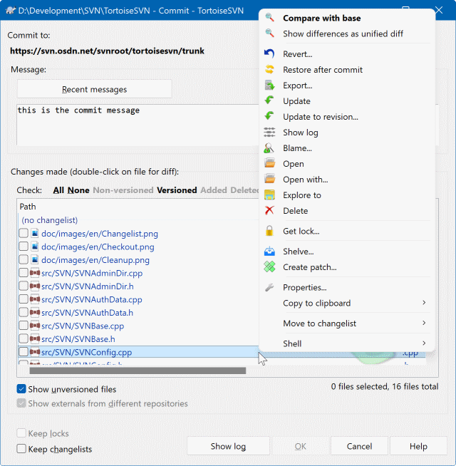

# SVN 图形化教程 · 编写规范

你要写的是**图形化操作**教程的某一节（HTML 片段，不是完整页面）。
读者是**不想用命令行**的 Windows 用户，用 TortoiseSVN + VisualSVN Server。

## 一、输出要求

- 只输出**单个 HTML 片段**（从 `<h3 class="sec" ...>` 开始，到本节内容结束），**不要** `<!DOCTYPE>`、`<html>`、`<head>`、`<body>`。
- **全中文**。不要出现命令行指令（`svn commit` 这类）作为操作方式——只在必要时顺带提一句「对应的命令行是 xxx」。
- 所有操作必须表述为**图形界面操作**：右键菜单、对话框、按钮、勾选框。
- 图片用 ``（相对路径，图片就在 `img/` 目录，稍后会复制进去）。
- 每节长度：**150~260 行 HTML**，内容要实在，不要凑字数。

## 二、必备的 HTML 骨架

```html
<h3 class="sec" id="sN"><span class="no">N</span>标题</h3>

<p class="lead">一句话说明这一节解决什么问题。</p>

<h4 class="sub">小标题</h4>
<p>正文...</p>

<div class="ops">
  <div class="otitle"><span class="badge">标签</span>操作组标题</div>
  <div class="op">
    <div class="num"></div>
    <div class="body">
      <span class="st">这一步的标题</span>
      <span class="sc">具体说明。<code class="ic">界面上的字样</code> 用这个样式。</span>
    </div>
  </div>
</div>
```

`id="sN"` 里的 N 就是节号（如第 5 节用 `id="s5"`）。

## 三、可用的 CSS 类（必须用这些，不要自己造样式）

| 类名 | 用途 | 写法 |
|---|---|---|
| `h3.sec` | 节标题 | `<h3 class="sec" id="s5"><span class="no">5</span>标题</h3>` |
| `h4.sub` | 二级小标题 | `<h4 class="sub">小标题</h4>` |
| `h5.mini` | 三级小标题 | `<h5 class="mini">更小的标题</h5>` |
| `p.lead` | 开篇导语 | `<p class="lead">...</p>` |
| `.ops > .otitle + .op` | **操作步骤列表**（最常用） | 见上方骨架 |
| `.shot` | **界面截图容器** | 见下方第四节 |
| `.box.tip` | 蓝色提示框（★） | `<div class="box tip"><span class="bt">标题</span><p>内容</p></div>` |
| `.box.warn` | 橙色警告（!） | 同上，`class="box warn"` |
| `.box.err` | 红色错误（X） | 同上，`class="box err"` |
| `.box.ok` | 绿色正确（✓） | 同上，`class="box ok"` |
| `.box.key` | 紫色重点（◈） | 同上，`class="box key"` |
| `.tw > table` | 表格 | `<div class="tw"><table><thead><tr><th>列</th></tr></thead><tbody><tr><td>值</td></tr></tbody></table></div>` |
| `.grid2 > .card` | 两栏卡片 | `<div class="grid2"><div class="card blue"><h6>标题</h6><ul><li>项</li></ul></div><div class="card good">...</div></div>` |
| `.duo` | 左右对照（错/对） | `<div class="duo"><div><div class="dh">✗ 错误</div><p>...</p></div><div><div class="dh">✓ 正确</div><p>...</p></div></div>` |
| `.mp` | **菜单路径**（关键样式） | `<span class="mp">TortoiseSVN <span class="ar">→</span> <span class="item">Commit...</span></span>` |
| `code.ic` | 界面上的文字/文件名 | `<code class="ic">OK</code>` |
| `kbd` | 键盘按键 | `<kbd>Ctrl</kbd>+<kbd>Shift</kbd>` |
| `.tagmini` | 小徽章 | `<span class="tagmini g">绿色对勾</span>`（g绿/r红/y黄/b蓝/p紫/c青） |
| `.iconrow > .ic-card` | 图标网格 | `<div class="iconrow"><div class="ic-card"><span class="nm">Modified</span><span class="ds">说明</span></div></div>` |

卡片配色：`card blue` / `card good`（绿）/ `card bad`（红）/ `card warn`（橙）/ `card pur`（紫）。

## 四、界面截图的写法

```html
<div class="shot">
  <div class="sh"><span class="ic">◈</span><span class="ft">图的标题</span><span class="fs">DIALOG NAME</span></div>
  <div class="sb"></div>
  <div class="cap">
    这里的说明文字。<b>关键按钮</b>用 b 标出，界面上的字样用 <span class="k">Message</span> 这种样式标出。
  </div>
</div>
```

- `class="sb"` 的 div 里放 `img`。
- `img` 可加样式类：默认宽度自适应；`class="small"`（最宽 420px，适合小菜单）、`class="mid"`（最宽 620px）。
- `class="bare"` 用于白底小图（如 Overlays.png），会给它加白底和圆角。
- `.cap` 里做**逐项解说**，说清图里每个区域是干什么的。

## 五、可用的图片清单（只能用这些，路径都是 `img/xxx.png`）

### 右键菜单与图标
| 文件 | 内容 |
|---|---|
| `Overlays.png` | 图标覆盖总表（绿勾/红叹号/黄锁/蓝加号等一堆文件图标，白底小图，用 `class="bare"`） |
| `ContextMenuDirControl.png` | 已版本控制文件夹的右键菜单（完整，含 TortoiseSVN 子菜单） |
| `ContextMenuDirNoControl.png` | 未版本控制文件夹的右键菜单（很短，4KB） |
| `ContextMenuFileControl.png` | 已版本控制文件的右键菜单 |
| `ContextMenuFileIgnore.png` | 未版本控制文件的右键菜单（很短） |
| `right-drag-menu.png` | 右键拖动松手后的菜单（249x193，小图，用 `class="small"`） |
| `statuslistoverlays.png` | 稀疏检出/外部引用的图标示例 |
| `AddedIcon.png` `ModifiedIcon.png` `DeletedIcon.png` `ConflictIcon.png` `IgnoredIcon.png` `LockedIcon.png` `UnversionedIcon.png` `ReadOnlyIcon.png` `InSubVersionIcon.png` | 单个 32x32 图标（适合放 `.iconrow` 图标网格里） |
| `ActionAddedIcon.png` `ActionDeletedIcon.png` `ActionMergedIcon.png` `ActionModifiedIcon.png` `ActionMovedIcon.png` `ActionReplacedIcon.png` `ActionReverseMergedIcon.png` `ActionMoveReplacedIcon.png` | 操作类小图标 |

### 检出 / 更新 / 提交
| 文件 | 内容 | 尺寸 |
|---|---|---|
| `Checkout.png` | **Checkout 对话框**（URL、检出目录、深度、版本） | 491x460 |
| `Commit.png` | **提交对话框**（文件勾选列表、Message 输入框、右键菜单展开） | 640x654，大图 |
| `CommitSpellcheck.png` | 提交对话框（拼写检查状态） | 602x498 |
| `CommitProgress.png` | **提交/检出进度对话框**（带颜色区分的文件列表） | 667x306 |
| `UpdateFinished.png` | **更新完成的进度对话框** | 670x336 |
| `CompareRevisions.png` | 比对两个版本 | 417x528 |
| `Cleanup.png` | **Clean up 对话框**（几个勾选项） | 417x308 |

### 历史 / 浏览
| 文件 | 内容 | 尺寸 |
|---|---|---|
| `LogMessages.png` | **Show log 日志对话框**（上方日志、下方文件列表） | 686x682，大图 |
| `LogMergeTrack.png` | 日志里的合并追踪显示（灰显已合并的版本） | 630x456 |
| `LogContextMenu.png` | 日志对话框里的右键菜单 | — |
| `LogCacheOffline.png` | 离线日志缓存 | — |
| `Repobrowser.png` | **Repo-browser 仓库浏览器**（左树右列表） | 677x588 |
| `revision-graph.png` | **Revision graph 版本拓扑图**（彩色分支线条） | 768x559，大图 |
| `RepoStatus.png` | **VisualSVN Server Manager 主界面** | 943x514，大图 |

### 撤销 / 比对
| 文件 | 内容 | 尺寸 |
|---|---|---|
| `Revert.png` | **Revert 撤销对话框**（列出要撤销的文件） | 543x498 |
| `TortoiseIDiff.png` | 图片比对工具（左右两张图并排） | 678x458 |
| `CompareRevisions.png` | 版本比对 | 417x528 |

### 分支 / 合并 / 切换
| 文件 | 内容 | 尺寸 |
|---|---|---|
| `Copy.png` | **Branch/Tag 对话框**（From/To/Destination URL、Log message、版本选择） | 586x700，大图 |
| `Switch.png` | **Switch 切换对话框** | 573x390 |
| `MergeWizardRange.png` | **合并向导 - 选择版本范围** | 549x512 |
| `MergeWizardTree.png` | 合并向导 - 两棵树合并 | — |
| `MergeConflictCallback.png` | **合并冲突对话框**（Accept base/incoming 等按钮） | 540x613 |
| `MergeTreeConflictCallback.png` | 树冲突对话框 | 540x485 |
| `MergeAll.png` | Merge all 对话框 | 407x320 |
| `ExportURL.png` | **Export 对话框** | 491x450 |
| `Import.png` | **Import 导入对话框** | 490x410 |

### 属性 / 锁
| 文件 | 内容 | 尺寸 |
|---|---|---|
| `Properties.png` | **属性标签页**（显示文件/目录的所有属性） | 407x577 |
| `PropertyList.png` | 属性列表 | 696x348 |
| `PropertyAdd.png` | **添加属性对话框**（属性名下拉 + 值输入） | 368x368 |
| `PropEditEol.png` | 编辑 svn:eol-style 属性 | 495x242 |
| `PropEditKeywords.png` | 编辑 svn:keywords 属性 | 490x240 |
| `PropEditNeedsLock.png` | 编辑 svn:needs-lock 属性 | 496x140 |
| `PropEditMimeType.png` | 编辑 svn:mime-type 属性 | 485x188 |
| `GetLock.png` | **Get Lock 加锁对话框**（可写备注、steal lock 选项） | 495x426 |

### 设置
| 文件 | 内容 | 尺寸 |
|---|---|---|
| `SettingsMain.png` | **Settings 设置主界面**（左侧分类树） | 734x559 |
| `SettingsOverlay.png` | 图标覆盖设置 | 734x559 |
| `SettingsOverlayChooser.png` | 图标覆盖选择 | — |
| `SettingsProgs.png` | 外部程序设置 | — |

### 统计
| 文件 | 内容 |
|---|---|
| `stats-by-author.png` / `StatsByAuthor.png` | 按作者统计提交量 |
| `merge-two-pane.png` | TortoiseMerge 双栏模式（左右对比） |
| `merge-three-pane.png` | TortoiseMerge 三栏模式（左中右，中间是合并结果） |

## 六、写作风格要求

1. **面向不想敲命令的人**。所有操作写成「右键 → 点 XX → 在对话框里填 YY」。
2. **每一步说清「为什么」**，不只是「怎么做」。
3. **善用 `.box.warn` 和 `.box.err`** 提醒常见坑（比如「别用 F2 重命名」「revert 不可逆」）。
4. **每张截图都要配 `.cap` 逐项解说**，把图里的区域/按钮解释清楚，用 `<b>` 标关键处。
5. 涉及菜单路径一律用 `.mp` 样式。
6. 不要编造界面里没有的按钮。不确定的地方就写通用表述。
7. 术语与人话并重：第一次出现专业词时用括号解释。

## 七、已知的事实（避免写错）

- TortoiseSVN 的顶层菜单项带 `SVN` 前缀（如 `SVN Commit...`），其余在 `TortoiseSVN` 子菜单里。
- 工作副本每个文件夹里都有 `.svn` 隐藏目录。
- 图标角标：绿色对勾=正常，红色叹号=已修改，黄色锁=已加锁，蓝色加号=已添加，灰色问号=未版本控制，红色叉=已删除，黄色底红叹号=冲突。
- Commit 对话框里：勾选框控制哪些文件被提交；`Message` 区填提交说明；上方 `Check:` 后面有 `All` / `Non-versioned` / `Versioned` / `Added` / `Deleted` 这些快速过滤链接；`Keep locks` 勾选后提交完不解锁。
- Revert 是**不可逆**的，会丢掉本地未提交的修改。
- 冲突时会产生 `.mine` / `.rN` 之类的辅助文件，解决后要告诉 SVN「已解决」。
- Show log 对话框：上方是提交历史列表，选中某个版本后，下方显示这次提交改了哪些文件；双击文件可以看差异。
- Branch/Tag 对话框：`From WC/URL` 是源，`To path` 是目标路径，`Log message` 填说明，下方选 `HEAD revision in the repository` 通常就够。
- Merge 向导第一步是选合并方式（Merge a range of revisions / Merge two different trees），然后选版本范围，`Test Merge` 可以预览不实际合并。
- VisualSVN Server Manager 左侧树：Repositories / Users / Groups / Jobs。
- 加锁（Get Lock）用于二进制文件，防止两人同时改。`svn:needs-lock` 属性设上后文件默认只读。
